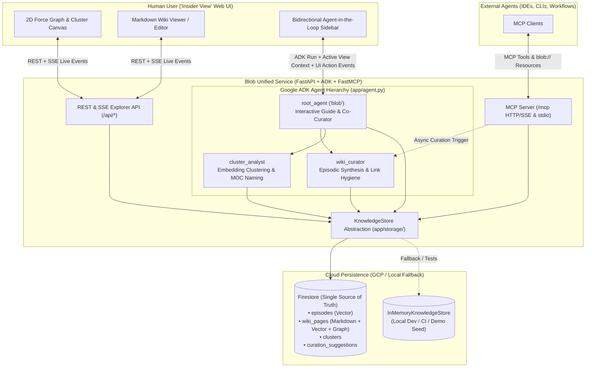

# Blob — Architecture & Design Specification

> **Status:** Approved Design Specification
> **Mission:** *"Blob is a memory fabric agent organizing the knowledge and memories of past interactions in a visual way."*
> **Deep-Dive Companion:** See [`spec/architecture-and-deployment.md`](architecture-and-deployment.md) for detailed sequence diagrams, state machines, ER diagrams, and the GCP Terraform/deployment plan.

---

## 1. Problem Statement & Vision

AI agents accumulate rich context across interactions—user preferences, architectural decisions, domain knowledge, and episodic history. Yet this memory layer typically suffers from three gaps:

1. **Opacity**: Users cannot easily inspect, audit, or visually explore what their agents actually know.
2. **Fragmentation**: Memories are trapped in flat vector chunks or isolated chat transcripts without synthesis, hierarchy, or relational links.
3. **No Co-Curation Loop**: When memories become stale, noisy, or contradictory, humans lack an interactive environment to reorganize knowledge alongside the agent.

**Blob** bridges agent knowledge and human understanding through:
- **Universal MCP Memory Server**: Any external agent connects via MCP (`remember`, `recall`, `get_page`, `traverse_graph`, `list_clusters`, `curate`) and `blob://` resources.
- **LLM-Wiki Synthesis & Obsidian Graph**: Memories are curated into Markdown-first Wiki pages with YAML frontmatter, inline `[[Wiki Links]]` (including "ghost nodes" for referenced-but-unwritten concepts), typed relations, and bidirectional backlinks.
- **Hybrid Semantic Clustering**: Vector embeddings group related pages into high-level semantic clusters, while the ADK Curator generates human-readable Cluster names and Map-of-Content (`MOC`) summaries.
- **Interactive "Insider View" UI**: A React + TypeScript (Vite) workspace combining a 2D Force-Directed Graph & Cluster Map, a live Markdown Wiki reader/editor, 1-click curation suggestions, and a bidirectional **Agent-in-the-Loop** chat sidebar.

---

## 2. System Architecture



---

## 3. Core Architectural Decisions

| Area | Decision | Details |
| :--- | :--- | :--- |
| **1. Cloud Storage** | **Firestore Single Source of Truth** | Firestore stores `episodes`, `wiki_pages` (Markdown body + metadata + graph edges), `clusters`, and `curation_suggestions` with Firestore Native Vector Search (`VectorValue` / `find_nearest`). YAML frontmatter + Markdown is serialized on the fly when needed. |
| **2. Local & Test Abstraction** | **`KnowledgeStore` Interface + Seed Data** | `app/storage/` defines a unified `KnowledgeStore` protocol with `FirestoreKnowledgeStore` (production/GCP) and `InMemoryKnowledgeStore` (unit/integration tests, offline dev, and instant seeded demo data). |
| **3. Ingestion & Curation** | **Two-Stage Async Pipeline** | 1. **Fast Ingest**: `remember` writes a raw `Episode` with its embedding to Firestore (`status="pending_curation"`) so it is immediately searchable (`<200ms`).<br>2. **Agentic Curation**: Background task (or explicit `curate` call) runs `wiki_curator` to synthesize pending episodes into Markdown `wiki_pages`, extract `[[wikilinks]]`, and resolve contradictions. |
| **4. Graph & Ghost Nodes** | **Obsidian-Faithful `[[Wiki Links]]` + Frontmatter Relations** | Inline `[[Page Title]]` or `[[slug\|Display]]` links are parsed on save. Links to pages that do not yet exist create lightweight **Ghost Nodes** (`status="ghost"`) in the graph, which can be synthesized into full pages on click or during curation. YAML frontmatter also supports typed `relations` (`part_of`, `depends_on`, `contradicts`, `relates_to`). |
| **5. Semantic Clustering** | **Hybrid Vector Clustering + ADK Naming** | Page embeddings are grouped into semantic clusters (with 2D `(x, y)` coordinates for map layout), and `cluster_analyst` generates human-readable cluster titles, summaries, colors, and Map-of-Content (`MOC`) overview pages. |
| **6. MCP Surface** | **FastAPI `/mcp` + `stdio` Entrypoint** | Built with the `mcp` SDK (`FastMCP`), mounted at `/mcp` on FastAPI and runnable via `uv run python -m app.mcp_server`. Exposes Tools (`remember`, `recall`, `get_page`, `traverse_graph`, `list_clusters`, `curate`) and Resources (`blob://wiki/{slug}`, `blob://clusters`, `blob://graph`). |
| **7. Scoping & Provenance** | **Unified Graph + Optional `namespace`** | Defaults to `namespace="default"` so memories cross-pollinate across external agents, while supporting custom namespaces and recording `source_agent`, `interaction_id`, and timestamps on every episode and wiki revision. |
| **8. ADK Agent Hierarchy** | **Root `blob` + Specialized Sub-Agents** | `root_agent` (`name="blob"`) acts as the interactive guide and co-curator, delegating synthesis and clustering tasks to `wiki_curator` and `cluster_analyst` sub-agents. |
| **9. Frontend Stack** | **React + TypeScript (Vite) in `frontend/`** | Split-pane Obsidian-inspired UI (2D Force Graph/Cluster Canvas + Markdown Wiki Reader/Editor + Agent Sidebar). Built static assets are served by FastAPI in production. |
| **10. Agent-in-the-Loop UX** | **Bidirectional Context & UI Actions** | The UI sends active view state (`active_page_slug`, `selected_cluster_id`, `visible_neighbors`) with every chat turn. `blob` can emit structured UI commands (`navigate_to_page`, `highlight_nodes`, `focus_cluster`, `refresh_page`) and surface 1-click curation suggestions on pages. |

---

## 4. Data Models

### 4.1 `Episode` (Firestore `episodes` collection)
```json
{
  "id": "ep-20261026-8f3a",
  "namespace": "default",
  "content": "User decided to use Firestore native vector search as the single source of truth for Blob.",
  "source_agent": "claude-code",
  "interaction_id": "sess-912",
  "tags": ["architecture", "storage", "gcp"],
  "status": "pending_curation",
  "synthesized_into": ["blob-storage-architecture"],
  "embedding": "<Vector[768]>",
  "created_at": "2026-10-26T10:40:00Z"
}
```

### 4.2 `WikiPage` (Firestore `wiki_pages` collection, serialized as Markdown + Frontmatter)
```markdown
---
slug: "blob-storage-architecture"
title: "Blob Storage Architecture"
namespace: "default"
status: "active" # "active" | "ghost" | "archived"
cluster_id: "cluster-system-architecture"
tags: ["architecture", "firestore"]
relations:
  - type: "part_of"
    target: "blob-system-design"
  - type: "relates_to"
    target: "mcp-memory-interface"
sources:
  - episode_id: "ep-20261026-8f3a"
    source_agent: "claude-code"
    timestamp: "2026-10-26T10:40:00Z"
updated_at: "2026-10-26T10:42:00Z"
---

# Blob Storage Architecture

Blob uses **Cloud Firestore** as its single source of truth for documents, graph edges, and embeddings as part of the [[Blob System Design]].

## Key Responsibilities
- **Firestore**: Unified store for `wiki_pages` (Markdown body, frontmatter metadata, graph links, and native vector search embeddings), `episodes`, and `clusters`.
- **Local Fallback**: Uses `InMemoryKnowledgeStore` for offline development and automated test suites, feeding into the [[MCP Memory Interface]].
```

### 4.3 `Cluster` (Firestore `clusters` collection)
```json
{
  "id": "cluster-system-architecture",
  "namespace": "default",
  "title": "System Architecture & Cloud Storage",
  "summary": "Core architectural decisions covering Firestore vector storage, graph indexing, and MCP service topology.",
  "color": "#6366f1",
  "page_slugs": ["blob-storage-architecture", "blob-system-design", "mcp-memory-interface"],
  "centroid_x": 0.42,
  "centroid_y": -0.18,
  "updated_at": "2026-10-26T10:45:00Z"
}
```

### 4.4 `CurationSuggestion` (Firestore `curation_suggestions` collection)
```json
{
  "id": "sug-001",
  "namespace": "default",
  "target_slug": "blob-storage-architecture",
  "kind": "unmerged_episodes",
  "title": "2 new episodes mention storage indexing",
  "description": "Merge recent interaction notes regarding composite vector indexes into this page.",
  "episode_ids": ["ep-20261026-9b1c"],
  "status": "open"
}
```

---

## 5. API & Protocol Specifications

### 5.1 MCP Server (`/mcp` & `stdio`)
- **Tools**:
  - `remember(content: str, source_agent: str = "external", tags: list[str] = [], namespace: str = "default", auto_curate: bool = True) -> dict`: Stores an episodic memory and queues background curation.
  - `recall(query: str, namespace: str = "default", top_k: int = 5, include_episodes: bool = True) -> dict`: Hybrid search across synthesized Wiki pages (vector + keyword + 1-hop graph neighbors) and recent unmerged episodes.
  - `get_page(slug_or_title: str, namespace: str = "default") -> dict`: Returns full Markdown, frontmatter, backlinks, outbound links, and provenance.
  - `traverse_graph(seed_slug: str, depth: int = 2, namespace: str = "default") -> dict`: Returns the local ego-graph (nodes, ghost nodes, typed edges, clusters) around a concept.
  - `list_clusters(namespace: str = "default") -> dict`: Returns the high-level semantic clusters and their member pages.
  - `curate(namespace: str = "default", focus_slug: str | None = None) -> dict`: Triggers the ADK `wiki_curator` and `cluster_analyst` pipeline on pending episodes.
- **Resources**:
  - `blob://wiki/{namespace}/{slug}` — Raw Markdown + frontmatter of a Wiki page.
  - `blob://clusters/{namespace}` — JSON map of semantic clusters.
  - `blob://graph/{namespace}` — Full node/edge graph snapshot.

### 5.2 "Insider View" REST & SSE Endpoints (`/api/*`)
- `GET /api/graph?namespace=default`: Full graph payload (`nodes` including ghost nodes + 2D coordinates, `edges` with types, `clusters`).
- `GET /api/pages?namespace=default`: List/search wiki pages.
- `GET /api/pages/{slug}?namespace=default`: Get single page + backlinks + open curation suggestions + source episodes.
- `PUT /api/pages/{slug}`: Create/update page from human Markdown edit (automatically re-parses `[[wikilinks]]`, updates ghost nodes, and re-embeds in Firestore).
- `DELETE /api/pages/{slug}`: Delete/archive a wiki page.
- `POST /api/episodes`: Add a memory or note directly from the UI.
- `GET /api/episodes?namespace=default&status=pending_curation`: Inspect the raw episodic inbox.
- `POST /api/curate`: Trigger ADK curation & clustering pass (`wiki_curator` + `cluster_analyst`).
- `POST /api/suggestions/{id}/apply` & `POST /api/suggestions/{id}/dismiss`: 1-click co-curation actions.
- `POST /api/seed`: Populate the store with a rich multi-cluster demo dataset for interactive exploration.
- `GET /api/events`: Server-Sent Events (SSE) stream notifying the frontend of live page edits, graph updates, and agent UI commands (`highlight_nodes`, `navigate_to_page`, `focus_cluster`).
