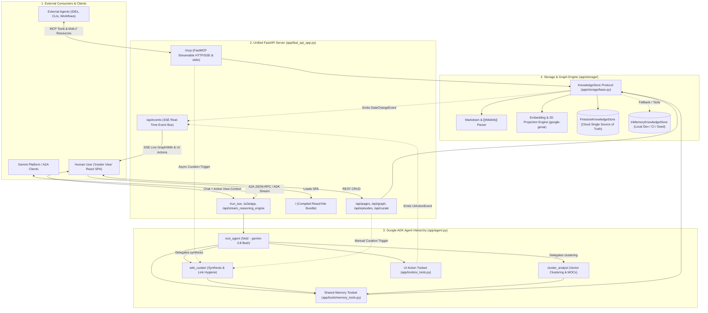
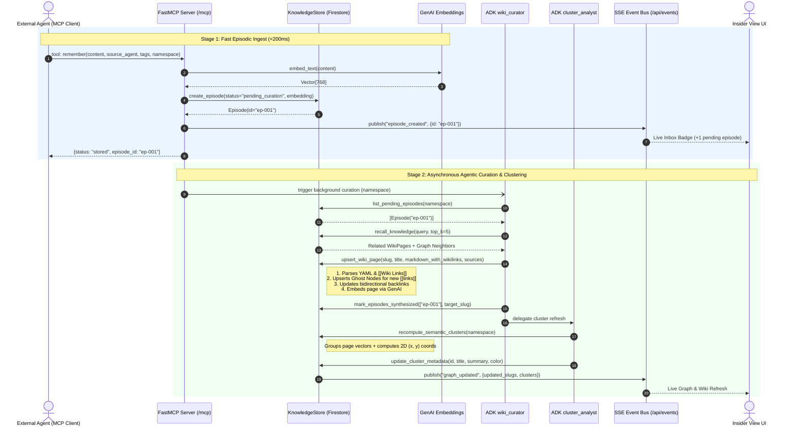
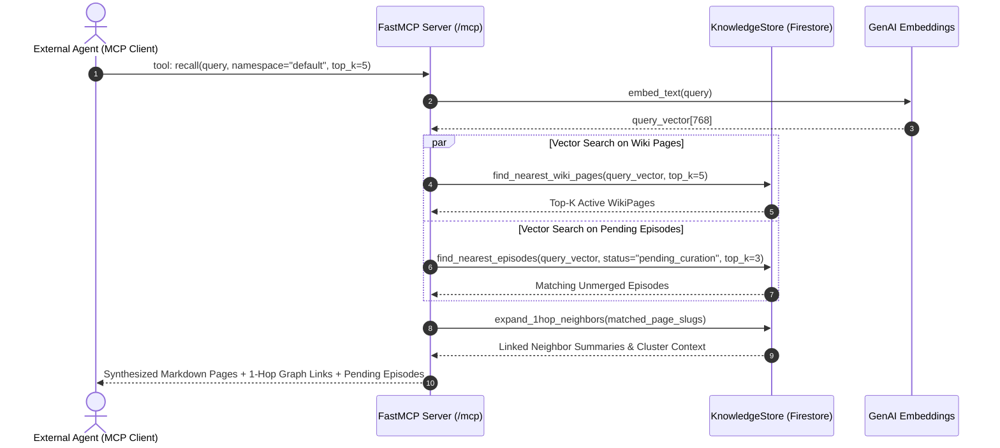
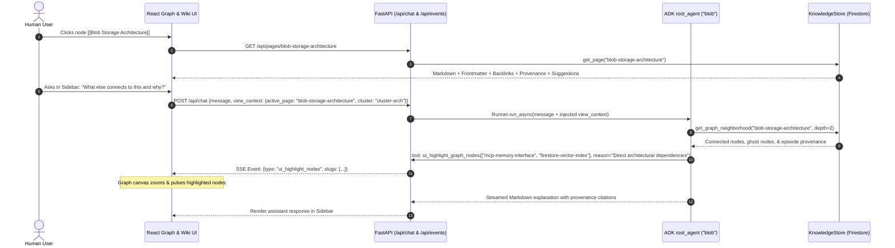
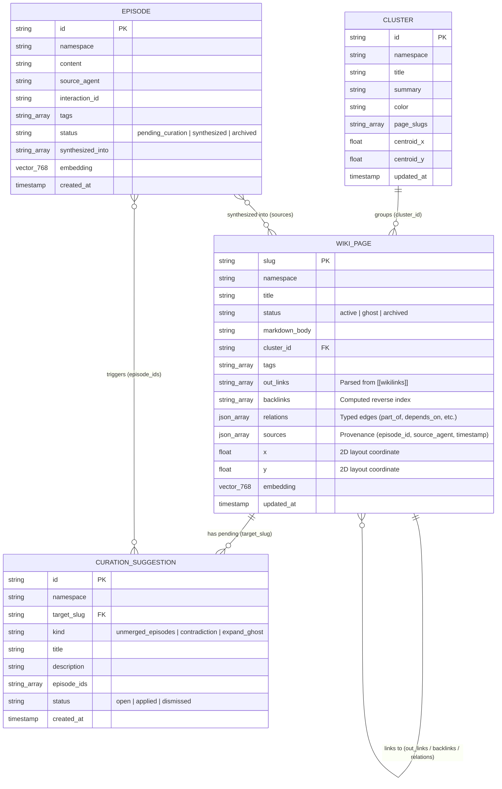
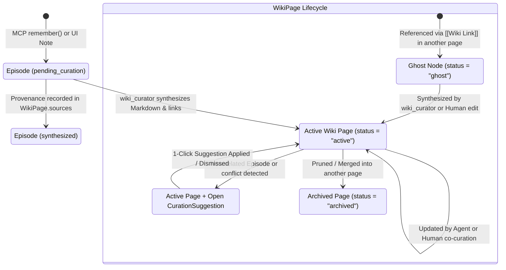
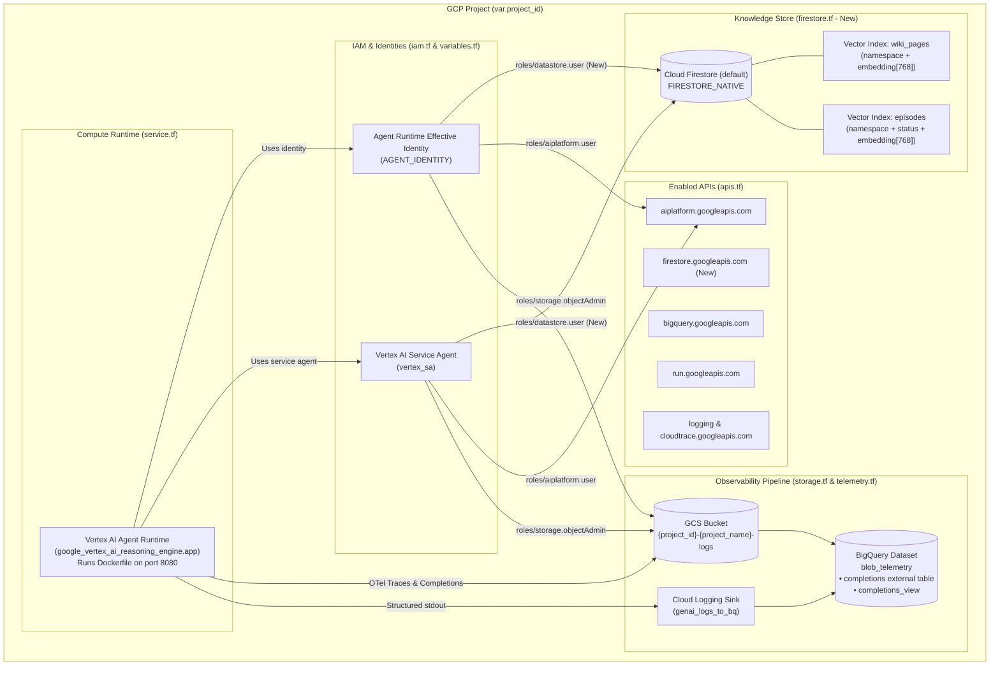
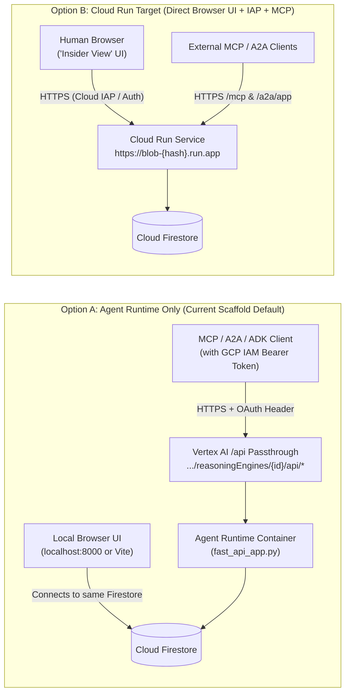

# Blob — Detailed System Architecture & GCP Deployment Plan

> **Companion to:** [`spec/README.md`](README.md)
> **Scope:** End-to-end runtime topology, sequence flows (MCP ingestion, agentic curation, bidirectional UI loop), data & state diagrams, and GCP Terraform/deployment architecture.

---

## 1. End-to-End Runtime Topology

Blob runs as a unified Python FastAPI application (`app/fast_api_app.py`) exposing **four distinct serving surfaces** over a shared ADK `Runner` and a pluggable `KnowledgeStore` backend:

1. **Universal MCP Server (`/mcp` HTTP/SSE & `stdio`)**: Connects external agents (IDE assistants, CLI tools, custom workflows) to the shared memory fabric.
2. **Explorer REST & SSE API (`/api/*`)**: Powers the visual graph canvas, Markdown wiki CRUD, 1-click curation suggestions, and real-time UI event streaming.
3. **ADK & A2A Agent Endpoints (`/run_sse`, `/a2a/app`, `/api/reasoning_engine`)**: Serves the conversational `blob` agent and multi-agent A2A protocol.
4. **"Insider View" Static SPA (`/`)**: Serves the compiled React + TypeScript (Vite) frontend bundle (`frontend/dist`).



---

## 2. Detailed Sequence Flows

### 2.1 Two-Stage Memory Ingestion & Agentic Curation Flow

When an external agent stores a memory via MCP, Blob separates **fast ingestion** from **agentic synthesis** so calling agents never block on multi-step LLM curation:

- **Stage 1 (Synchronous, `<200ms`)**: Embeds the raw observation and writes an `Episode` (`status="pending_curation"`) to Firestore. Because `episodes` has a vector index, the memory is immediately retrievable via `recall()`.
- **Stage 2 (Asynchronous Background Pass)**: `wiki_curator` synthesizes pending episodes into Markdown `WikiPage` documents, parses inline `[[Wiki Links]]`, creates **Ghost Nodes** for referenced-but-unwritten pages, recalculates bidirectional backlinks, and triggers `cluster_analyst` to update semantic clusters.



---

### 2.2 Hybrid Recall Flow (External Agent Query)

When an external agent calls `recall(query)`, Blob combines **vector similarity across Wiki pages**, **1-hop graph neighborhood expansion**, and **recent unmerged episodes**:



---

### 2.3 Bidirectional "Agent-in-the-Loop" UI Exploration Flow

In the **Insider View**, the human user and the `blob` ADK agent share a live feedback loop:
1. **UI $\rightarrow$ Agent Context**: Every user message automatically attaches the current view state (`active_page_slug`, `selected_cluster_id`, `visible_neighbors`).
2. **Agent $\rightarrow$ UI Control**: `blob` can invoke UI action tools (`ui_highlight_graph_nodes`, `ui_navigate_to_page`, `ui_focus_cluster`) and memory mutation tools (`upsert_wiki_page`), which stream over `/api/events` to animate the React graph and update the Markdown editor in real time.



---

## 3. Data Model & Knowledge Lifecycle

### 3.1 Firestore Entity-Relationship Diagram

All persistent state lives in **four Firestore collections** (`episodes`, `wiki_pages`, `clusters`, `curation_suggestions`) scoped by `namespace` (defaulting to `"default"`):



### 3.2 Wiki Node & Episode State Machine



---

## 4. GCP Infrastructure & Deployment Architecture

### 4.1 Terraform Resource Topology (`deployment/terraform/single-project/`)

All GCP resources are managed declaratively in `deployment/terraform/single-project/`:



### 4.2 Planned Terraform Changes (`deployment/terraform/single-project/`)

1. **`apis.tf`**:
   - Add `"firestore.googleapis.com"` to `local.services`.
2. **`variables.tf`**:
   - Add `"roles/datastore.user"` to both `var.app_sa_roles` and `var.agent_identity_roles` so the runtime container can read/write Firestore documents and execute vector similarity queries.
3. **`firestore.tf` (New File)**:
   - `google_firestore_database.default`: Provisions the `(default)` Firestore database in `FIRESTORE_NATIVE` mode in `var.region`.
   - `google_firestore_index.wiki_pages_vector`: Composite vector index on collection `wiki_pages` (`namespace` ASC + `embedding` vector `dimension = 768`, `flat`).
   - `google_firestore_index.episodes_vector`: Composite vector index on collection `episodes` (`namespace` ASC + `status` ASC + `embedding` vector `dimension = 768`, `flat`).

---

### 4.3 Serving Topologies on GCP: Agent Runtime vs. Cloud Run

Because the container (`Dockerfile` running `uvicorn app.fast_api_app:app --host 0.0.0.0 --port 8080`) packages the **ADK Agent**, **A2A Server**, **MCP Server (`/mcp`)**, **Explorer API (`/api/*`)**, and **React UI (`frontend/dist`)** into a single image, it can be deployed in two ways depending on how you want to access the Web UI:



- **Option A — Agent Runtime (`deployment_target: "agent_runtime"`, current default)**:
  - Managed Vertex AI Reasoning Engine deployment via `agents-cli deploy`.
  - Exposes all FastAPI routes under `https://{region}-aiplatform.googleapis.com/reasoningEngines/v1/projects/{project}/locations/{region}/reasoningEngines/{id}/api/{route}` (authenticated via Google Cloud IAM Bearer tokens).
  - Ideal for Gemini platform registration (`agents-cli publish gemini`), A2A calls, and IAM-authenticated MCP clients, while the React UI can be run locally (`agents-cli playground` / `uvicorn`) connected to the same Cloud Firestore database or hosted as a decoupled Cloud Run UI.
- **Option B — Cloud Run (`agents-cli scaffold enhance . --deployment-target cloud_run`)**:
  - Deploys the exact same `Dockerfile` to Cloud Run with a direct `https://blob-....run.app` URL.
  - Allows opening the **"Insider View" React UI** directly in any browser (optionally protected with Google sign-in via `--iap`).

---

## 5. Step-by-Step Deployment & Verification Runbook

1. **Local Development & Interactive Testing**:
   ```bash
   # Uses InMemoryKnowledgeStore by default, or Firestore when GOOGLE_CLOUD_PROJECT is set
   agents-cli install
   agents-cli playground
   ```

2. **Pre-Deployment Automated Checks**:
   ```bash
   # Unit & integration test suites
   uv run pytest tests/unit tests/integration

   # Code quality & type checks
   agents-cli lint

   # Agent evaluation suite
   agents-cli eval run
   ```

3. **Provision Single-Project GCP Infrastructure (Terraform)**:
   ```bash
   # Ensure deployment/terraform/single-project/vars/env.tfvars has your project_id
   agents-cli infra single-project --apply
   ```

4. **Deploy to GCP (Requires Explicit Human Approval)**:
   ```bash
   # Deploy container to configured target
   agents-cli deploy
   ```
